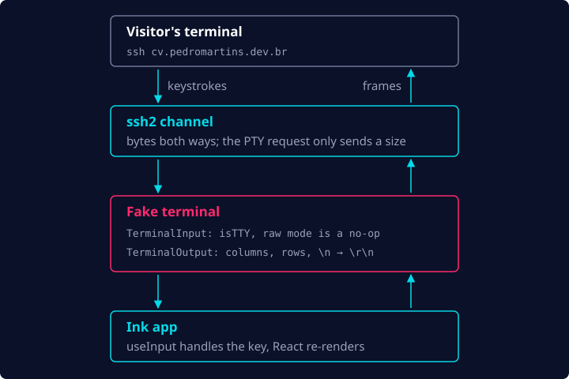

One day I was watching a Primeagen video when he announced his product, terminal.shop, an online
shop that sells coffee and is accessed via… SSH! This was the first time I'd stumbled upon such a
concept, and I quickly opened my terminal to try it out. Once I ran `ssh terminal.shop`, a TUI app
was rendered on my screen and I could interact with it using the keyboard. I was mind-blown! Very
quickly I wanted to understand how that was possible, and most importantly, how I could build my
own.

## How does that even work?

So I began the research…

Apparently, terminal.shop was open source at some point, so if you ask any LLM, it will quickly
tell you roughly what the stack behind it is:

- **Go** as the programming language
- **Bubble Tea** as the TUI renderer
- **Wish** handling the SSH connections

Learning about the tech stack made things start to seem less like magic and more like
engineering. I could now see how the pieces fit together, and I quickly started to plan how I could
reproduce this idea in TypeScript:

- An SSH connection is simply a TCP connection on port 22. From a network perspective, it's no
  different from an HTTP call, just a different protocol on top.
- Under the hood, the SSH server gives the client's session a PTY (pseudo-terminal) connected to an
  actual shell (which runs Unix commands), and the shell's output is sent back to the SSH client.

So I'd basically need a server listening on port 22 that "spoke" the SSH protocol and could hand
the SSH client a PTY capable of rendering a TUI.

I found some libs in the Node ecosystem that could help me with that:

- [`ssh2`](https://github.com/mscdotnet/ssh2) lets a Node.js app expose an SSH server
- [Ink](https://github.com/vadimdemedes/ink) lets React components be rendered in the terminal

## My CV as a terminal app served over SSH

I had this idea: what if I could serve my CV over SSH the same way? It would be a nice piece of
portfolio and would help me better understand how all this works, but it would also be a nice way
to make my CV stand out among thousands, possibly millions, of other developers' CVs.

I had all the pieces to put this together and go live with this idea… Or so I thought.

I quickly created a new repo, scaffolded a simple Node.js app and had Claude Code set up the basics
for ssh2 and Ink. Then I had to decide how to actually provide the CV data itself. I decided to
have Markdown files that live in the repo and are bundled together with the server, one file per
section:

```
content/
  _header.md         the banner: my name and a tagline
  01-about.md        every other file is a tab, ordered by its number
  02-experience.md
  03-projects.md
  04-contact.md
```

For the Markdown to ANSI conversion, I used
[`marked-terminal`](https://github.com/mikaelbr/marked-terminal).

With all that stitched together, things started to come to life. I still had a few things to
think about:

- What the TUI would look like
- How to handle navigation
- How the heck I was going to deploy this thing to the internet

## Tabs and keys

For the TUI's look and feel, I decided to use tabs for the different sections of my CV (About,
Experience, Projects and Contact), and navigation would work via the keyboard, very similar to
terminal.shop, which this project was heavily inspired by. Ink's `useInput` hook makes the keys
part almost boring:

```ts
useInput((input, key) => {
  if (input === 'q' || key.escape || (key.ctrl && input === 'c')) quit();
  else if (key.rightArrow || input === 'l' || (key.tab && !key.shift))
    switchSection(activeSectionIndex + 1);
  else if (key.leftArrow || input === 'h' || (key.tab && key.shift))
    switchSection(activeSectionIndex - 1);
  else if (/^[1-9]$/.test(input) && Number(input) <= sectionCount) switchSection(Number(input) - 1);
  else if (key.downArrow || input === 'j') scroll.scrollBy(1);
  else if (key.upArrow || input === 'k') scroll.scrollBy(-1);
  // ...plus page up and down, top and bottom
});
```

<!-- TODO(author): TUI screenshot here -->

## There is no PTY

The part that wasn't boring at all was connecting ssh2 to Ink. I was surprised to learn that Claude
had to implement most of that heavy lifting itself, and the reason is that the PTY from my plan
doesn't exist. The client still asks for one, but all the server gets out of that request is the
size of the client's terminal. What ssh2 actually hands over is a channel: a plain stream of bytes
in both directions, with no kernel terminal in between.

Ink, on the other hand, expects a real terminal: a stdin it can put in raw mode and a stdout that
knows its columns and rows. So the app fakes both on top of the channel:

```ts
/** Ink needs a raw-mode TTY; ssh already put the client's terminal in raw mode. */
export class TerminalInput extends PassThrough {
  readonly isTTY = true;

  setRawMode(_enabled: boolean): this {
    return this;
  }
}

/** No kernel PTY sits in between, so nothing else translates "\n" to "\r\n". */
export class TerminalOutput extends Writable {
  readonly isTTY = true;

  override _write(chunk, _encoding, callback) {
    const text = typeof chunk === 'string' ? chunk : chunk.toString('utf8');
    this.channel.write(text.replace(/\r?\n/g, '\r\n'), () => callback());
  }

  resize(windowSize: WindowSize): void {
    this.columns = windowSize.cols;
    this.rows = windowSize.rows;
    this.emit('resize');
  }
}
```

Each session then renders the app into that fake terminal instead of `process.stdout`:

```tsx
render(<App {...appProps} />, {
  stdin: terminal.stdin,
  stdout: terminal.stdout,
  alternateScreen: true,
  exitOnCtrlC: false,
});
```

From there, a keystroke travels from the visitor's terminal through the channel into Ink, which
interprets it and tells the UI how to re-render, and the new frame goes back down the same channel:



Thank god we have GenAI nowadays :D

## Up next

At this point `ssh -p 2222 localhost` showed my CV, tabs and all. That left the last question on my
list: how to put it on the internet. In the next post I do that without exposing my home network
and without leaving the door open to a surprise cloud bill.
