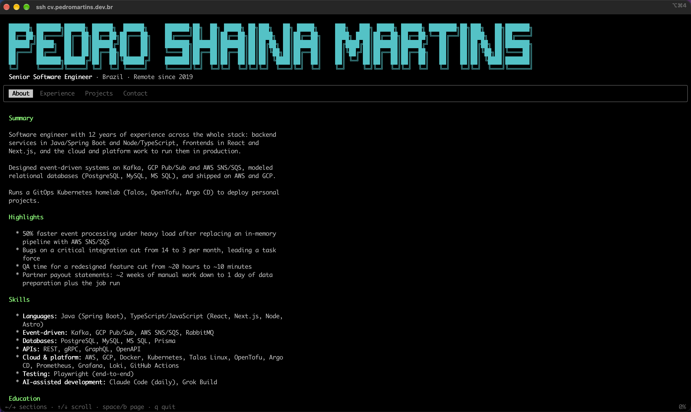
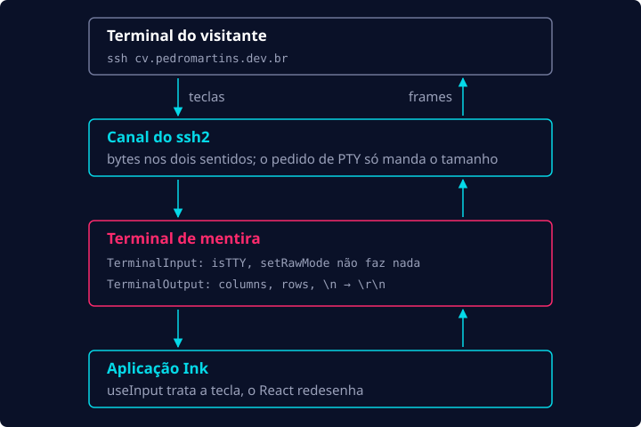

Um dia eu estava assistindo um vídeo do Primeagen quando ele anunciou o produto dele, o
terminal.shop, uma loja online que vende café e que você acessa via… SSH! Foi a primeira vez que eu
esbarrei num conceito desses, e na hora abri o terminal para testar. Assim que rodei
`ssh terminal.shop`, uma aplicação TUI apareceu na minha tela e dava para interagir com ela pelo
teclado. Fiquei de cara! Rapidinho eu já queria entender como aquilo era possível e, mais
importante, como eu podia construir o meu.

## Como isso funciona?

Então comecei a pesquisar…

Pelo visto, o terminal.shop foi open source em algum momento, então se você perguntar para
qualquer LLM, ela logo te diz mais ou menos qual é a stack por trás:

- **Go** como linguagem
- **Bubble Tea** para renderizar a TUI
- **Wish** cuidando das conexões SSH

Conhecer a stack fez a coisa parecer menos mágica e mais engenharia. Agora eu conseguia ver como as
peças se encaixavam, e logo comecei a planejar como reproduzir a ideia em TypeScript:

- Uma conexão SSH é só uma conexão TCP na porta 22. Do ponto de vista da rede, não é diferente de
  uma chamada HTTP, só muda o protocolo por cima.
- Por baixo dos panos, o servidor SSH dá para a sessão do cliente um PTY (pseudoterminal) ligado a
  um shell de verdade (que executa comandos Unix), e a saída do shell volta para o cliente SSH.

Ou seja, eu basicamente precisava de um servidor escutando na porta 22 que "falasse" o protocolo SSH
e conseguisse entregar para o cliente SSH um PTY capaz de renderizar uma TUI.

Encontrei algumas libs no ecossistema Node que podiam me ajudar com isso:

- [`ssh2`](https://github.com/mscdotnet/ssh2) permite que uma aplicação Node.js exponha um servidor
  SSH
- [`Ink`](https://github.com/vadimdemedes/ink) permite renderizar componentes React no terminal

## Meu currículo como uma aplicação de terminal via SSH

Tive uma ideia: e se eu servisse meu currículo via SSH do mesmo jeito? Seria uma boa peça de
portfólio, me ajudaria a entender melhor como tudo isso funciona e, no fim das contas, era um jeito
legal de fazer meu currículo se destacar entre milhares, talvez milhões, de currículos de outros
devs.

Eu tinha todas as peças para colocar essa ideia no ar… Pelo menos era o que eu achava.

Criei um repositório novo, montei uma aplicação Node.js simples e pedi para o Claude Code configurar
o básico do ssh2 e do Ink. Aí eu precisava decidir de onde viria o conteúdo do currículo em si.
Decidi usar arquivos Markdown que ficam no repositório e vão junto com o servidor, um arquivo por
seção:

```
content/
  _header.md         o banner: meu nome e uma frase de apresentação
  01-about.md        todo outro arquivo vira uma aba, na ordem do número
  02-experience.md
  03-projects.md
  04-contact.md
```

Para converter o Markdown em ANSI, usei o
[`marked-terminal`](https://github.com/mikaelbr/marked-terminal).

Com tudo isso costurado, a coisa começou a ganhar vida. Mas ainda faltava pensar em algumas coisas:

- Como a TUI ia ficar visualmente
- Como seria a navegação
- Como diabos eu ia fazer o deploy disso na internet

## Abas e teclas

Para o visual da TUI, decidi usar abas para as diferentes seções do meu currículo (About,
Experience, Projects e Contact), com navegação pelo teclado, bem parecido com o terminal.shop, que
foi a grande inspiração do projeto. Com o hook `useInput` do Ink, a parte das teclas fica quase
chata:

```ts
useInput((input, key) => {
  if (input === 'q' || key.escape || (key.ctrl && input === 'c')) quit();
  else if (key.rightArrow || input === 'l' || (key.tab && !key.shift))
    switchSection(activeSectionIndex + 1);
  else if (key.leftArrow || input === 'h' || (key.tab && key.shift))
    switchSection(activeSectionIndex - 1);
  else if (/^[1-9]$/.test(input) && Number(input) <= sectionCount) switchSection(Number(input) - 1);
  else if (key.downArrow || input === 'j') scroll.scrollBy(1);
  else if (key.upArrow || input === 'k') scroll.scrollBy(-1);
  // ...mais page up e page down, topo e fim
});
```



## Não tem PTY

A parte que não teve nada de chata foi ligar o ssh2 ao Ink. Fiquei surpreso ao ver que o Claude
teve que implementar boa parte desse trabalho pesado na mão, e o motivo é que o PTY do meu plano
não existe. O cliente até pede um, mas tudo o que o servidor recebe nesse pedido é o tamanho do
terminal do cliente. O que o ssh2 entrega de verdade é um canal: um fluxo de bytes nos dois
sentidos, sem nenhum terminal do kernel no meio.

Já o Ink espera um terminal de verdade: um stdin que ele possa colocar em raw mode e um stdout que
saiba quantas colunas e linhas tem. Então a aplicação finge os dois em cima do canal:

```ts
/** O Ink precisa de um TTY em raw mode; o ssh já colocou o terminal do cliente em raw mode. */
export class TerminalInput extends PassThrough {
  readonly isTTY = true;

  setRawMode(_enabled: boolean): this {
    return this;
  }
}

/** Não tem PTY do kernel no meio, então ninguém mais traduz "\n" para "\r\n". */
export class TerminalOutput extends Writable {
  readonly isTTY = true;

  override _write(chunk, _encoding, callback) {
    const text = typeof chunk === 'string' ? chunk : chunk.toString('utf8');
    this.channel.write(text.replace(/\r?\n/g, '\r\n'), () => callback());
  }

  resize(windowSize: WindowSize): void {
    this.columns = windowSize.cols;
    this.rows = windowSize.rows;
    this.emit('resize');
  }
}
```

Cada sessão então renderiza a aplicação nesse terminal de mentira, em vez do `process.stdout`:

```tsx
render(<App {...appProps} />, {
  stdin: terminal.stdin,
  stdout: terminal.stdout,
  alternateScreen: true,
  exitOnCtrlC: false,
});
```

A partir daí, uma tecla sai do terminal do visitante, passa pelo canal e chega no Ink, que
interpreta a tecla e diz para a UI como se redesenhar, e o novo frame volta pelo mesmo canal:



Sinceramente, eu não me imaginava implementando tudo isso sozinho num experimento de aprendizado
como esse. Ainda bem que hoje em dia a gente tem IA generativa :D

## No próximo post

Até aqui, `ssh -p 2222 localhost` já mostrava meu currículo, com abas e tudo. Faltava a última
pergunta da lista: como colocar isso na internet. No próximo post eu faço isso sem expor a rede da
minha casa e sem deixar a porta aberta para uma conta surpresa na nuvem.
