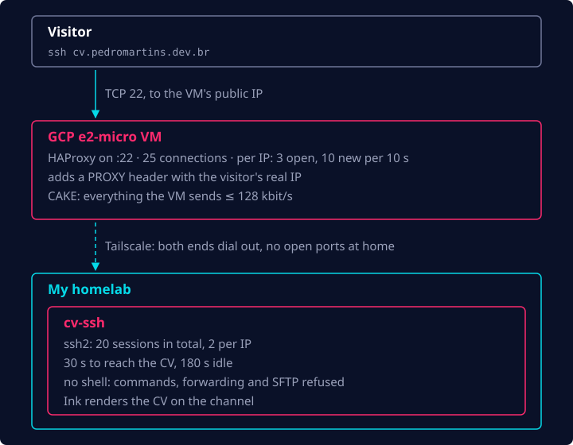

In the [previous post](/blog/cv-ssh-building-the-tui/), my CV became a TUI served over SSH, running
on my machine. Now, deploying this on the internet was the interesting part.

## Getting SSH out of my home

From the get-go I was very skeptical and paranoid about security, so I started researching what
could go wrong by opening this up publicly:

- **First challenge: how to expose a TCP server on port 22.** This is the same challenge I faced
  when I deployed yabe to the internet for the first time: public IPs behind CGNAT, ISPs blocking
  port forwarding for ports below 1024, etc. This time it was even harder, since the solution I used
  for yabe, [Cloudflare Tunnel](/blog/homelab-going-live/), is built for HTTP traffic. It can carry
  SSH, but only if every visitor installs `cloudflared` on their own machine, and nobody is going to
  do that to read a CV.
- Furthermore, not using Cloudflare Tunnel meant I would need to expose my home network's public IP
  under the domain name so people could reach it.
- I'd also lose lots of security features that come by default with Cloudflare: WAF, rate limiting,
  etc.

I knew I didn't want to hand out my public IP so freely, so I began looking for alternatives.
Basically, the only realistic alternative that would keep costs under $10/month (I didn't want to
spend more than that on a pet project) was renting a virtual private server and using it as a relay
between my home network and the internet. And that's what I did.

I started looking for the cheapest solution I could find and ended up landing on GCP: its free tier
includes an `e2-micro` instance with 1 GB of egress traffic per month, which is more than enough to
send CV text over the wire. The static public IP isn't free, though: it costs about US$3.65/month.

So the whole setup looks something like:

```
User SSH -> GCP VM -> Tailscale -> My homelab
```

This solves the public IP part, since my DNS record now points to GCP's public IP, and the
connection between GCP and my home network is handled privately by Tailscale. Both ends dial out to
Tailscale, so my home network still has no open ports.

## What could go wrong

But there were still so many things that could go wrong. My main concerns were:

- I didn't want the SSH server to be an attack surface to my homelab network or devices
- I didn't want to be surprised by a big GCP bill out of nowhere because someone decided to point a
  botnet at my domain name

So I started looking into mitigating all these possibilities.

### The SSH server

First, I learned that ssh2 never hands a shell to the connection: there is no shell behind the
server at all, only the CV app, which already reduces the attack surface a lot. After that, I
decided to cap what the SSH client could ask from the server. I disabled port forwarding, SFTP and
pretty much every other request a client could send to an SSH server. Commands get a one-line
refusal, and forwarding attempts are rejected and logged, since a normal visitor never sends one:

```ts
session.on('exec', (accept, _reject, execInfo) => {
  connectionLogger.info({ command: execInfo.command }, 'exec refused');
  refuseChannel(accept(), REFUSAL_MESSAGES['commands-unsupported']);
});

// Forwarding would make the server a proxy into its network.
client.on('tcpip', (_accept, reject, { destIP, destPort }) => {
  connectionLogger.warn(
    { kind: 'direct-tcpip', dest: `${destIP}:${destPort}` },
    'forwarding refused',
  );
  reject();
});
```

After that, I was still worried about DDoS and resource-hijacking attacks, so I implemented a few
more things: a cap on the number of sessions open at the same time (20), a per-IP cap (2 sessions
per address) and two timeouts: 30 seconds to get from connecting to the CV on screen, and 180
seconds without a keypress.

### The edge

However, this only covers the SSH server and my homelab side of things. If you remember the
connection flow above, there's still the entry point on GCP, and since GCP charges for egress
traffic, that needed to be protected as well.

For the GCP edge, I decided to keep it simple. The VM was already running HAProxy to forward the
clients' real IP addresses to the SSH server (in a PROXY protocol header) for the per-IP cap, so
naturally I used it to enforce per-IP limits on the public edge as well:

```
frontend ssh
  bind :22
  maxconn 25
  # Per visitor IP: at most 3 connections open and 10 new ones per 10 s
  stick-table type ip size 10k expire 60s store conn_cur,conn_rate(10s)
  tcp-request connection track-sc0 src
  tcp-request connection reject if { sc_conn_cur(0) gt 3 }
  tcp-request connection reject if { sc_conn_rate(0) gt 10 }
  default_backend cv_ssh

backend cv_ssh
  server cv-ssh cv-ssh.<tailnet>:22 send-proxy-v2
```

Then I used CAKE as a traffic shaper to limit everything the VM sends to 128 kbit/s. It's a single
`tc` command, run at boot:

```
tc qdisc replace dev ens4 root cake bandwidth 128kbit
```

This limits the amount of egress traffic the VM can serve in a given period of time, and in my
setup it does two things:

- If someone decides to hammer the server with requests, the edge slows down for everyone instead of
  sending more. CAKE queues per flow, so a normal session stays usable next to a heavy one.
- It caps what a botnet could add to my GCP bill. Running flat out for a whole month, 128 kbit/s is
  about 42 GB, or roughly US$4.90 of egress. With the IP, the worst case is about US$8.55/month, still
  under my US$10/month budget.

## A terminal in the browser

Now I had it up and running and it was working flawlessly. I was so stoked to finally get it done!
However, I still felt like something was missing. It was cool to know it worked and to be able to
talk about it, but it was very hard to actually show it to people: they would need a terminal at
hand and a basic understanding of how to connect to SSH servers. Even though this was initially
aimed at technical people, I still felt like I could provide something easier for the
non-tech-savvy. So I started thinking about building a UI for it.

I wanted the experience to be similar to opening a terminal window and actually connecting to the
SSH server, so I configured an HTTP server on the same Node.js app that was already running the SSH
server and started brainstorming the solution with Claude.

The result? [cv-ssh.pedromartins.dev.br](https://cv-ssh.pedromartins.dev.br)! A web page that
renders a terminal-like window, plays an animation of `ssh cv.pedromartins.dev.br` being typed into
the terminal, and mimics the TUI's look, feel and navigation.

## Putting it together

This is the path a visitor's `ssh` takes, with every limit along the way:



That concludes my journey from being inspired by terminal.shop to deploying my own TUI-over-SSH
application! If you want to understand better how this works and build your own, check out
[the project's public GitHub repository](https://github.com/pedroshaina/cv-ssh), or try it yourself:

```
ssh cv.pedromartins.dev.br
```
