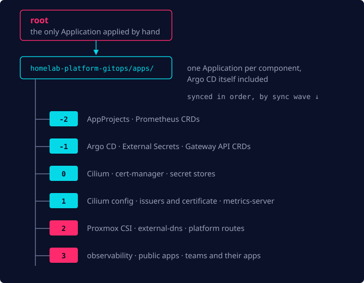
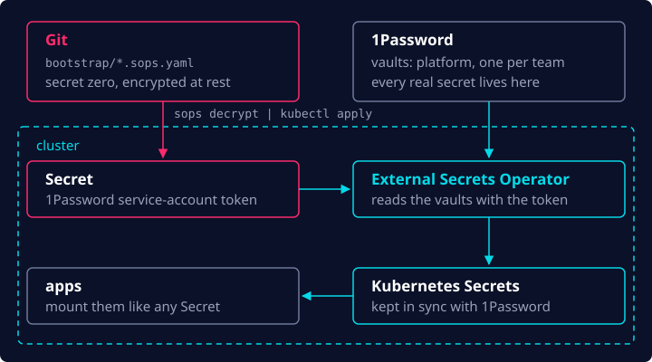

In the [first post](/blog/homelab-mini-pc-to-kubernetes/), I went from a mini PC to an empty
Kubernetes cluster. Now it was time to make Git the source of truth for everything that runs in it.

## GitOps: Argo CD

I had to decide which GitOps tool would manage the cluster. There are basically two mainstream
options: Argo CD and Flux CD. For me, this was an easy choice. I went with Argo CD because I'd
used it in production before, and in my experience more companies use Argo than Flux. The UI is a
nice bonus, too.

Following common practice and the official Argo CD documentation, I implemented the
**app-of-apps** pattern: one `root` application is deployed by hand first, and from there it
manages every other application, Argo CD itself included.

```yaml
apiVersion: argoproj.io/v1alpha1
kind: Application
metadata:
  name: root
  namespace: argocd
spec:
  project: platform
  source:
    repoURL: git@github.com:pedroshaina/homelab-platform-gitops.git
    targetRevision: main
    path: apps # one Application per component lives here
  destination:
    server: https://kubernetes.default.svc
    namespace: argocd
  syncPolicy:
    automated:
      prune: true # deleted from Git → deleted from the cluster
      selfHeal: true # changed by hand → changed back
```

That `syncPolicy` is what makes Git win every time. If I remove something from the repo, Argo CD
removes it from the cluster; if I tweak something by hand with `kubectl`, Argo CD puts it back.

Order matters, though: a `Certificate` can't be created before cert-manager exists. Each
Application has a sync-wave annotation, and Argo CD syncs the waves in order, lowest first:



## Secrets

Once all that was settled, I needed a way to handle in-cluster secrets. I wanted it to be secure
and production-like from day one, so I chose to run ESO (External Secrets Operator). Since I
already had a 1Password subscription, I used it as the backend.

That leaves one secret ESO can't fetch for itself: the token it uses to authenticate to the
1Password vault, the "secret zero". That one lives in Git, encrypted at rest with SOPS, and it's
decrypted and applied once, when the cluster is bootstrapped.



An app never knows 1Password exists. It asks for a secret with an `ExternalSecret`, and ESO turns
it into a regular Kubernetes `Secret` and refreshes it every hour. This is the one cert-manager uses
to talk to Cloudflare:

```yaml
apiVersion: external-secrets.io/v1
kind: ExternalSecret
metadata:
  name: cloudflare-api-token
  namespace: cert-manager
spec:
  refreshInterval: 1h
  secretStoreRef: { kind: ClusterSecretStore, name: platform } # the platform vault
  target:
    name: cloudflare-api-token
  data:
    - secretKey: api-token
      remoteRef:
        key: cert-manager-cloudflare-api-token/api-token # 1Password item/field
```

No plain-text secret ever reaches Git, and rotating a secret means changing it in 1Password
instead of committing anything.

## The foundations

I'd put some pieces of the puzzle together, but I still had some foundational ones to take care
of:

- **CNI:** networking and IP address management (IPAM) inside the cluster
- **CSI:** persistent storage for the cluster
- how to expose services to the internet
- DNS management
- TLS handling

The first two are below. The other three are all about reaching the cluster, so they get [their
own post](/blog/homelab-going-live/).

### Networking: Cilium

For cluster networking and IPAM I went with Cilium. It's the industry standard, and it does a lot
with few moving pieces. In my cluster it:

- replaces kube-proxy entirely;
- hands out LoadBalancer IPs on my home network and announces them with L2 announcements, so I
  don't need MetalLB;
- implements the Gateway API, so I don't need a separate ingress controller either;
- ships Hubble, which shows me which pod is talking to which.

There's one chicken-and-egg problem: without a CNI the node never becomes `Ready`, so Argo CD can't
run to install one. OpenTofu installs Cilium when it builds the cluster, and Argo CD takes it over
from there, using the same values file so the two never disagree.

### Storage: Proxmox CSI

Proxmox CSI was my storage choice. It attaches Proxmox volumes to the cluster and maps them to
PersistentVolumes, which makes it very similar to a cloud-managed solution like EBS and very easy
to manage at home. Every `PersistentVolumeClaim` becomes a disk on the NVMe:

```yaml
apiVersion: storage.k8s.io/v1
kind: StorageClass
metadata:
  name: proxmox-lvm
  annotations:
    storageclass.kubernetes.io/is-default-class: 'true'
provisioner: csi.proxmox.sinextra.dev
parameters:
  storage: local-lvm
  csi.storage.k8s.io/fstype: ext4
  ssd: 'true'
reclaimPolicy: Delete # apps that must keep their data opt into Retain
volumeBindingMode: WaitForFirstConsumer
allowVolumeExpansion: true
```

## Up next

At this point the cluster could run anything Git told it to, but only I could reach it. In the
last post I open it up to the internet, give it DNS and TLS, and deploy my first app.
