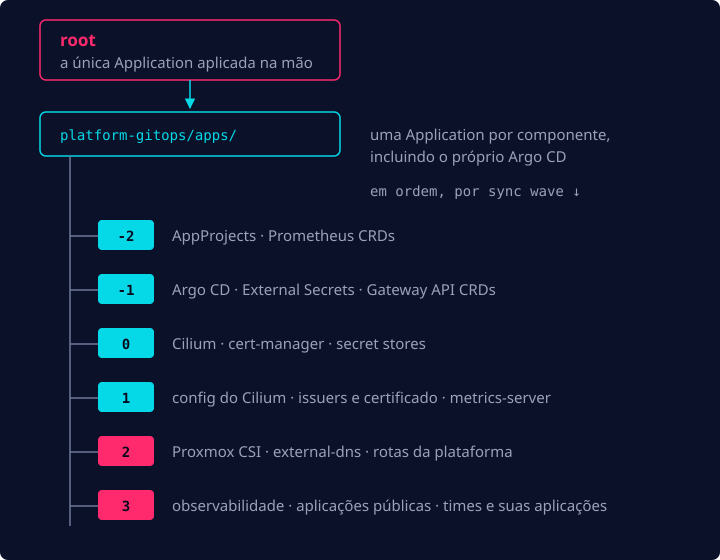
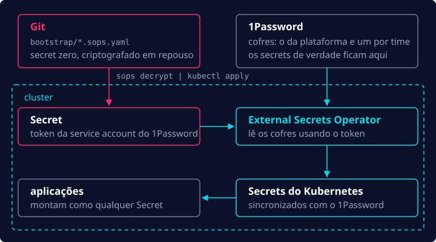

No [primeiro post](/pt-br/blog/homelab-mini-pc-to-kubernetes/), comecei com um mini PC e cheguei a um
cluster Kubernetes vazio. Agora era hora de fazer do Git a fonte da verdade para tudo que roda nele.

## GitOps: Argo CD

Primeiro, eu precisava escolher a ferramenta de GitOps que ia gerenciar o cluster. Basicamente, tem
duas opções mais usadas: Argo CD e Flux CD. Pra mim foi uma escolha fácil, fui de Argo CD porque já
tinha usado em produção, e pela minha experiência mais empresas usam Argo do que Flux. E a interface web é um bônus.

Seguindo o que é comum no mercado e a própria documentação do Argo CD, implementei o padrão
**app-of-apps**: primeiro eu faço o deploy de uma aplicação `root` na mão, e a partir daí ela
gerencia todas as outras, inclusive o próprio Argo CD.

```yaml
apiVersion: argoproj.io/v1alpha1
kind: Application
metadata:
  name: root
  namespace: argocd
spec:
  project: platform
  source:
    repoURL: git@github.com:your-github-user/platform-gitops.git
    targetRevision: main
    path: apps # aqui fica uma Application por componente
  destination:
    server: https://kubernetes.default.svc
    namespace: argocd
  syncPolicy:
    automated:
      prune: true # removido do Git → removido do cluster
      selfHeal: true # alterado na mão → revertido
```

É essa `syncPolicy` que garante que o Git sempre vence. Se eu removo algo do repositório, o Argo CD
remove do cluster; se eu altero algo na mão com `kubectl`, o Argo CD desfaz.

Mas a ordem importa: um `Certificate` não pode ser criado antes de o cert-manager existir. Cada
Application tem uma annotation de sync wave, e o Argo CD sincroniza as waves em ordem, da menor
para a maior:



## Secrets

Com tudo isso resolvido, eu precisava de uma forma de lidar com os secrets dentro do cluster. Queria
algo seguro e com cara de produção desde o primeiro dia, então escolhi rodar o ESO (External
Secrets Operator). Como eu já tinha uma assinatura do 1Password, usei ele como backend.

Sobra só um secret que o ESO não tem como buscar sozinho: o token que ele usa para se autenticar no
cofre do 1Password, o "secret zero". Esse fica no Git, criptografado em repouso com SOPS, e só é
descriptografado e aplicado uma vez, no bootstrap do cluster.



As aplicações nem sabem que o 1Password existe. Elas pedem o secret por meio de um
`ExternalSecret`, e o ESO converte isso num `Secret` comum do Kubernetes, que ele atualiza de hora
em hora. Este aqui é o que o cert-manager usa para falar com a Cloudflare:

```yaml
apiVersion: external-secrets.io/v1
kind: ExternalSecret
metadata:
  name: cloudflare-api-token
  namespace: cert-manager
spec:
  refreshInterval: 1h
  secretStoreRef: { kind: ClusterSecretStore, name: platform } # o cofre da plataforma
  target:
    name: cloudflare-api-token
  data:
    - secretKey: api-token
      remoteRef:
        key: cert-manager-cloudflare-api-token/api-token # item/campo no 1Password
```

Nenhum secret em texto puro vai parar no Git, e para rotacionar um secret basta trocá-lo no
1Password, sem commitar nada.

## A base

Algumas peças do quebra-cabeça já estavam no lugar, mas ainda faltavam outras tão importantes quanto:

- **CNI:** rede e gerenciamento de endereços IP (IPAM) dentro do cluster
- **CSI:** armazenamento persistente para o cluster
- como expor serviços para a internet
- gerenciamento de DNS
- TLS

Sobre os dois primeiros pontos, eu falo aqui embaixo. Os outros três têm a ver com acessar o cluster através da internet, então
ganharam [um post só para eles](/pt-br/blog/homelab-going-live/).

### Rede: Cilium

Para a rede e o IPAM do cluster, escolhi o Cilium. Ele é o padrão de mercado e resolve bastante coisa com poucas dependências. No meu cluster, ele:

- substitui o kube-proxy por completo;
- distribui IPs de LoadBalancer na minha rede e os anuncia com L2 announcements, substituindo o MetalLB;
- implementa a Gateway API, removendo a necessidade de um ingress controller separado;
- vem com o Hubble, que me mostra qual pod está chamando qual.

O problema de instalar o Cilium 100% via GitOps é que sem um CNI, o node nunca fica `Ready`, então o Argo CD não consegue rodar para realizar a instalação. Desta forma, o OpenTofu instala o Cilium
quando cria o cluster, e daí em diante o Argo CD assume, usando o mesmo arquivo de values, assim os
dois nunca divergem.

### Armazenamento: Proxmox CSI

Para armazenamento, fui de Proxmox CSI. Ele anexa volumes do Proxmox ao cluster e os expõe como
PersistentVolumes. Na prática, funciona de um jeito bem parecido com uma solução gerenciada de
cloud, como o EBS, e é bem fácil de manter. Cada `PersistentVolumeClaim` vira um disco no
NVMe:

```yaml
apiVersion: storage.k8s.io/v1
kind: StorageClass
metadata:
  name: proxmox-lvm
  annotations:
    storageclass.kubernetes.io/is-default-class: 'true'
provisioner: csi.proxmox.sinextra.dev
parameters:
  storage: local-lvm
  csi.storage.k8s.io/fstype: ext4
  ssd: 'true'
reclaimPolicy: Delete # aplicações que precisam manter os dados usam Retain
volumeBindingMode: WaitForFirstConsumer
allowVolumeExpansion: true
```

## No próximo post

Até este ponto, o cluster já rodava qualquer coisa que o Git mandasse, mas apenas eu conseguia acessá-lo. No
último post eu abro o cluster para a internet, configuro DNS e TLS e faço o deploy da minha primeira
aplicação.
