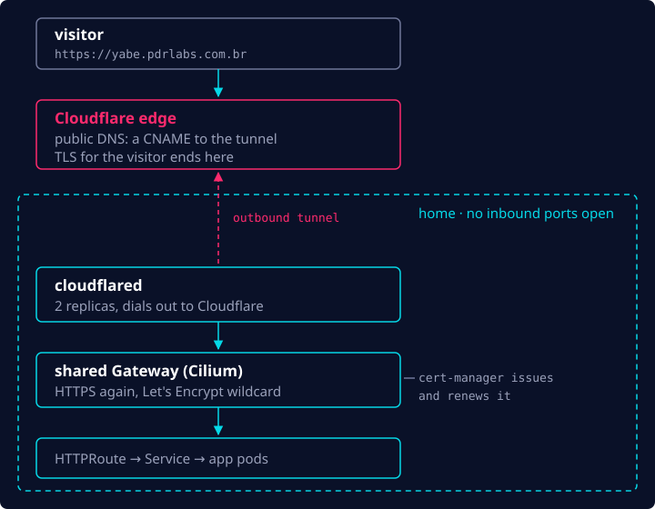
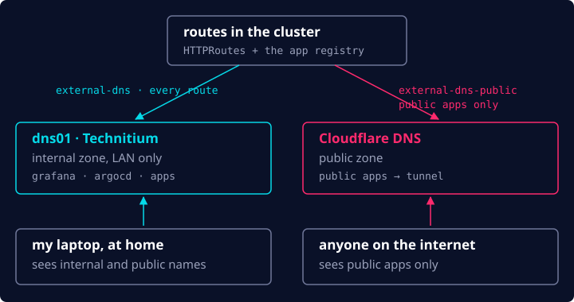

In the [previous post](/blog/homelab-gitops-foundations/), Git took over the cluster. Three
foundational pieces were still missing, all about reaching it from the outside: exposing services to the internet,
DNS and TLS. With those in place, I could finally deploy something real.

## Exposing services to the internet

Exposing services to the internet from home can be tricky. Typically you'd rely on port forwarding
to route inbound requests from your public IP to an internal one. However:

- Many ISPs put their customers behind **CGNAT**, which makes the public IP shared among several
  customers. There's no way to tell which machine the traffic should be routed to.
- Many residential plans forbid opening ports 80 and 443. That forces services onto other ports
  (typically above 1024) and defeats the purpose, since now the URL has to carry the port too:
  `https://app.example.com:8443`.

Thankfully, there's an alternative that's actually much easier to set up and manage: **Cloudflare
Tunnel**. `cloudflared` runs inside the cluster and dials _out_ to Cloudflare, so the request
comes in over a connection my network opened itself. No ports are open at home.



The only downside is that all that traffic is now visible to Cloudflare, which is a trade-off I'm
willing to make.

Nothing is public by default. Each app opts in with one flag in the platform's app registry:

```yaml
teams:
  - name: apps
    repo: git@github.com:your-github-user/apps-gitops.git
    apps:
      - { name: yabe, public: true }
```

## DNS

Since Cloudflare was already in the stack, I used it to manage DNS as well. The external-dns
controller creates the records automatically, so I never touch DNS by hand.

I also wanted a **split-DNS** setup, where some services only resolve on my home network and
others are public. For the internal names I run Technitium in a small container next to the
cluster (the `dns01` box from part 1). So there are actually two external-dns instances:



Grafana, the Argo CD UI and similar platform tools resolve only at home, and the internet only learns about the
apps I flagged as public.

## TLS

TLS is handled in two places. Cloudflare terminates TLS for visitors at the edge. Behind it,
cert-manager issues a Let's Encrypt wildcard certificate (DNS-01, through the Cloudflare API) and
renews it automatically. The hop from `cloudflared` to the Gateway is HTTPS too, and internal
names get a real certificate instead of a browser warning.

## The first app: yabe

Once all that was in place, I was ready to deploy the first publicly accessible app, wire it all
up and test the whole architecture end-to-end.

[yabe](https://yabe.pdrlabs.com.br) is a Bitcoin block explorer I'd been working on, and it was
ready to go to production. Deploying it basically took two things:

1. **One entry in the platform's app registry** (the snippet above). This provisions the app's
   `Namespace` in the cluster and its Argo CD `Application`.
2. **The app's manifests in the apps GitOps repo:** `Deployment`, `Service`, `HTTPRoute`, etc.

The `HTTPRoute` is what ties the app to the shared Gateway, and to both DNS zones:

```yaml
apiVersion: gateway.networking.k8s.io/v1
kind: HTTPRoute
metadata:
  name: yabe
spec:
  parentRefs:
    - { name: shared, namespace: gateway, sectionName: https-apps }
  hostnames:
    - yabe.pdrlabs.com.br
  rules:
    - backendRefs:
        - { name: yabe, port: 8080 }
```

After that, I set up GitHub Actions to build the app's images on every merge to `main`, push them
to GHCR, and pin them by digest in the GitOps repo. From there, Argo CD syncs the app and the
Kubernetes reconciliation loop kicks in. Rolling back is just reverting that commit.

## Observability

Now that I had an actual app running in the cluster, I needed a way to check its logs and see
whether anything was going wrong in production, so I started working on observability.

I picked **kube-prometheus-stack** as the core of it. It bundles Prometheus, Grafana and
Alertmanager, is very easy to set up and comes with good defaults to get started. Metrics are kept
for 30 days, and alerts go to Discord.

For logging I went with **Loki + Alloy**. It was the cheapest stack to run in terms of hardware
and fit nicely into the rest of the setup. Alloy collects every pod's logs and ships them to Loki,
which keeps them for 14 days. Grafana shows both logs and metrics, side by side.

## Wrapping up

That concludes the journey from zero to production on my homelab. Nowadays there are a few more
apps running (this site is one of them) and a couple of extra moving pieces, but the core
foundation described in this series is still there.

If you're interested in building your own, I've written a complete step-by-step guide in a public
GitHub repo: [pedroshaina/k8s-homelab](https://github.com/pedroshaina/k8s-homelab).
