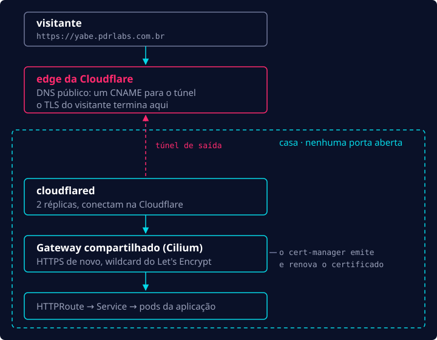
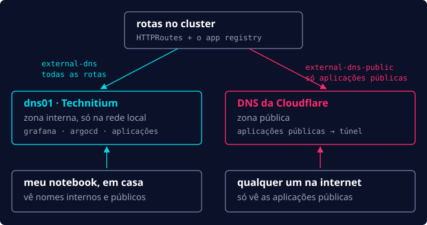

No [post anterior](/pt-br/blog/homelab-gitops-foundations/), o Git assumiu o cluster. Ainda faltavam
três peças básicas, todas ligadas a acessar o cluster de fora: expor serviços na internet, DNS e
TLS. Com isso resolvido, eu finalmente ia poder fazer o deploy de algo de verdade.

## Expondo serviços na internet

Expor serviços na internet a partir de uma rede residencial pode ser complicado. O normal seria usar port
forwarding para encaminhar as requisições que chegam no seu IP público para um IP interno. Só que:

- Muitos provedores colocam os clientes atrás de **CGNAT**, ou seja, o mesmo IP público é
  compartilhado por vários clientes. Não tem como saber para qual máquina mandar o tráfego.
- Muitos planos residenciais proíbem abrir as portas 80 e 443. Isso obriga os serviços a usar
  outras portas (normalmente acima de 1024), o que meio que perde o sentido, porque a URL passa a
  ter que incluir a porta: `https://app.example.com:8443`.

Felizmente, tem uma alternativa que, de quebra, é bem mais fácil de configurar e manter: o
**Cloudflare Tunnel**. O `cloudflared` roda dentro do cluster e faz a conexão _de saída_ até a
Cloudflare, então a requisição chega por uma conexão aberta de dentro da minha rede. Não preciso
abrir nenhuma porta em casa.



A única desvantagem é que a Cloudflare passa a enxergar todo esse tráfego, mas é um trade-off que
eu topo.

No meu setup, nada é público por padrão. Cada aplicação só fica pública se eu ligar uma flag no app registry da
plataforma:

```yaml
teams:
  - name: apps
    repo: git@github.com:your-github-user/apps-gitops.git
    apps:
      - { name: yabe, public: true }
```

## DNS

Como a Cloudflare já fazia parte da stack, aproveitei e usei ela para o DNS também. O controller
external-dns cria os registros automaticamente, desta forma eu nunca mexo no DNS na mão.

Eu também queria um setup de **split DNS**, em que alguns serviços só resolvem na minha rede de
casa e outros são públicos. Para os nomes internos, rodo o Technitium em um pequeno container ao
lado do cluster (o container `dns01` da parte 1). Então, na verdade, são duas instâncias do
external-dns:



O Grafana, a interface do Argo CD e outras ferramentas da plataforma só resolvem na minha rede, e a
internet só fica sabendo das aplicações que marquei como públicas.

## TLS

O TLS acontece em dois pontos. No edge, a Cloudflare faz a terminação TLS para os visitantes. Atrás
dela, o cert-manager emite um certificado wildcard do Let's Encrypt (DNS-01, pela API da
Cloudflare) e o renova automaticamente. A conexão entre o `cloudflared` e o Gateway do cluster também é HTTPS, e
os nomes internos ganham um certificado de verdade ao invés daquele aviso chato no navegador.

## A primeira aplicação: yabe

Com tudo pronto, eu já podia fazer o deploy da primeira aplicação pública, amarrar
tudo e testar a arquitetura inteira de ponta a ponta.

O [yabe](https://yabe.pdrlabs.com.br) é um block explorer de Bitcoin que eu vinha desenvolvendo e
que já estava pronto para ir para produção. Para colocar no ar, bastaram basicamente duas coisas:

1. **Uma entrada no app registry da plataforma** (o trecho acima). Isso cria o `Namespace` da
   aplicação no cluster e a `Application` dela no Argo CD.
2. **Os manifestos da aplicação no repositório GitOps de aplicações:** `Deployment`, `Service`,
   `HTTPRoute` etc.

O `HTTPRoute` é o que liga a aplicação ao Gateway compartilhado e às duas zonas de DNS:

```yaml
apiVersion: gateway.networking.k8s.io/v1
kind: HTTPRoute
metadata:
  name: yabe
spec:
  parentRefs:
    - { name: shared, namespace: gateway, sectionName: https-apps }
  hostnames:
    - yabe.pdrlabs.com.br
  rules:
    - backendRefs:
        - { name: yabe, port: 8080 }
```

Depois disso, configurei o GitHub Actions para buildar as imagens da aplicação a cada merge na
`main`, fazer push para o GHCR e fixar o digest delas no repositório GitOps. A partir daí, o Argo CD
sincroniza a aplicação e o loop de reconciliação do Kubernetes entra em ação. Para fazer rollback basta
reverter esse commit.

## Observabilidade

Agora que eu tinha uma aplicação de verdade rodando no cluster, precisava de uma forma de ver os
logs dela e saber se algo estava dando errado em produção, então comecei a trabalhar na
observabilidade.

A base de tudo é a **kube-prometheus-stack**. Ela junta Prometheus, Grafana e Alertmanager, é muito
fácil de configurar e já vem com defaults bons para começar. As métricas ficam guardadas por 30
dias, e os alertas vão para o Discord.

Para logs, fui de **Loki + Alloy**. Era a stack mais leve para o hardware e se encaixou bem no resto do
setup. O Alloy coleta os logs de todos os pods e manda para o Loki, que guarda tudo por 14 dias. O
Grafana mostra logs e métricas lado a lado.

## Para fechar

E assim termina a jornada do zero à produção no meu homelab. Hoje já tem mais algumas aplicações
rodando (este site é uma delas) e algumas peças a mais, mas a base que descrevi nesta série continua
a mesma.

Se você quiser montar o seu, escrevi um guia completo, passo a passo, num repositório público no GitHub (apenas em inglês por enquanto):
[pedroshaina/k8s-homelab](https://github.com/pedroshaina/k8s-homelab).
