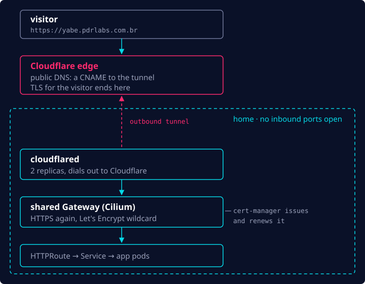
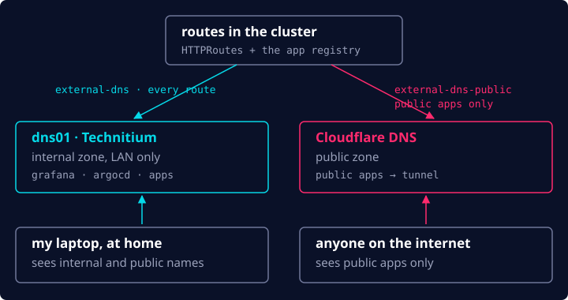

No [post anterior](/pt-br/blog/homelab-gitops-foundations/), o Git assumiu o cluster. Ainda faltavam
três peças fundamentais, todas sobre como acessá-lo de fora: expor serviços para a internet, DNS e
TLS. Com elas no lugar, eu finalmente poderia fazer o deploy de algo de verdade.

## Expondo serviços para a internet

Expor serviços para a internet a partir de casa pode ser complicado. Normalmente você dependeria de
port forwarding para encaminhar as requisições de entrada do seu IP público para um IP interno. Só
que:

- Muitos provedores colocam seus clientes atrás de **CGNAT**, o que faz o IP público ser
  compartilhado entre vários clientes. Não há como saber para qual máquina o tráfego deve ser
  encaminhado.
- Muitos planos residenciais proíbem abrir as portas 80 e 443. Isso força os serviços a usarem
  outras portas (normalmente acima de 1024) e acaba com o propósito, já que agora a URL também
  precisa carregar a porta: `https://app.example.com:8443`.

Felizmente, existe uma alternativa que é bem mais fácil de configurar e gerenciar: o **Cloudflare
Tunnel**. O `cloudflared` roda dentro do cluster e faz a conexão _de saída_ até a Cloudflare, então
a requisição chega por uma conexão que a minha própria rede abriu. Nenhuma porta fica aberta em
casa.



A única desvantagem é que todo esse tráfego passa a ser visível para a Cloudflare, um trade-off que
estou disposto a aceitar.

Nada é público por padrão. Cada aplicação opta por isso com uma flag no registro de aplicações da
plataforma:

```yaml
teams:
  - name: apps
    repo: git@github.com:your-github-user/apps-gitops.git
    apps:
      - { name: yabe, public: true }
```

## DNS

Como a Cloudflare já fazia parte da stack, usei ela para gerenciar o DNS também. O controller
external-dns cria os registros automaticamente, então eu nunca mexo no DNS na mão.

Eu também queria um setup de **split DNS**, em que alguns serviços só resolvem na minha rede de
casa e outros são públicos. Para os nomes internos, rodo o Technitium em um pequeno container ao
lado do cluster (a caixa `dns01` da parte 1). Então, na verdade, são duas instâncias do
external-dns:



O Grafana, a interface do Argo CD e outras ferramentas da plataforma só resolvem em casa, e a
internet só fica sabendo das aplicações que marquei como públicas.

## TLS

O TLS é tratado em dois lugares. A Cloudflare termina o TLS dos visitantes na borda. Por trás dela,
o cert-manager emite um certificado wildcard do Let's Encrypt (DNS-01, pela API da Cloudflare) e o
renova automaticamente. O trecho entre o `cloudflared` e o Gateway também é HTTPS, e os nomes
internos ganham um certificado de verdade em vez de um aviso do navegador.

## A primeira aplicação: yabe

Com tudo isso no lugar, eu estava pronto para fazer o deploy da primeira aplicação acessível
publicamente, conectar todas as peças e testar a arquitetura inteira de ponta a ponta.

O [yabe](https://yabe.pdrlabs.com.br) é um block explorer de Bitcoin em que eu vinha trabalhando, e
ele estava pronto para ir para produção. O deploy dele precisou basicamente de duas coisas:

1. **Uma entrada no registro de aplicações da plataforma** (o trecho acima). Isso provisiona o
   `Namespace` da aplicação no cluster e a sua `Application` do Argo CD.
2. **Os manifestos da aplicação no repositório GitOps de apps:** `Deployment`, `Service`,
   `HTTPRoute` etc.

O `HTTPRoute` é o que liga a aplicação ao Gateway compartilhado e às duas zonas de DNS:

```yaml
apiVersion: gateway.networking.k8s.io/v1
kind: HTTPRoute
metadata:
  name: yabe
spec:
  parentRefs:
    - { name: shared, namespace: gateway, sectionName: https-apps }
  hostnames:
    - yabe.pdrlabs.com.br
  rules:
    - backendRefs:
        - { name: yabe, port: 8080 }
```

Depois disso, configurei o GitHub Actions para buildar as imagens da aplicação a cada merge na
`main`, publicá-las no GHCR e fixá-las por digest no repositório GitOps. A partir daí, o Argo CD
sincroniza a aplicação e o loop de reconciliação do Kubernetes entra em ação. Fazer rollback é só
reverter esse commit.

## Observabilidade

Agora que eu tinha uma aplicação de verdade rodando no cluster, precisava de uma forma de ver os
logs dela e saber se algo estava dando errado em produção, então comecei a trabalhar na
observabilidade.

Escolhi a **kube-prometheus-stack** como o núcleo dela. Ela junta Prometheus, Grafana e
Alertmanager, é muito fácil de configurar e vem com bons padrões para começar. As métricas ficam
guardadas por 30 dias, e os alertas vão para o Discord.

Para logs, fui de **Loki + Alloy**. Era a stack mais barata de rodar em termos de hardware e se
encaixou bem no resto do setup. O Alloy coleta os logs de todos os pods e os envia para o Loki, que
os guarda por 14 dias. O Grafana mostra logs e métricas lado a lado.

## Concluindo

Isso encerra a jornada do zero à produção no meu homelab. Hoje em dia há mais algumas aplicações
rodando (este site é uma delas) e algumas peças móveis a mais, mas a fundação descrita nesta série
continua lá.

Se você tem interesse em montar o seu, escrevi um guia completo, passo a passo, em um repositório
público no GitHub: [pedroshaina/k8s-homelab](https://github.com/pedroshaina/k8s-homelab).
