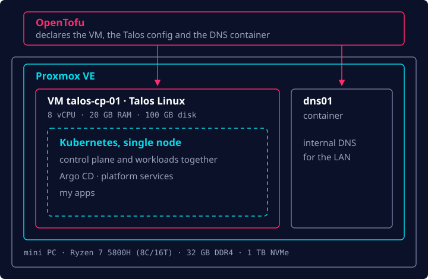

For most of my career, I've been developing software and working with Ops/Platform tools
(Kubernetes, OCI/Docker containers, Terraform, etc.), but mostly as a user. I rarely had the chance
to take part in setting up a project from scratch. Because of that, I've wanted for a long time to
actually understand how things work end-to-end, and I decided to change that by building and
operating a homelab.

This is the first of three posts about it. In this one I go from bare metal to a running
Kubernetes cluster. The next one is about letting Git run that cluster, and the last one is about
putting a real app on the internet.

## How it all started

A few years ago, a good friend of mine sold me a GenMachine mini PC and kept pushing me to build my
own homelab. Naturally, I kept postponing it for a long time, but over the past couple of months I
went all in, and now I've got a humble yet capable setup running.

First, let's take a peek at the hardware specs:

- **CPU:** Ryzen 7 5800H, 8 cores / 16 threads @ 3.2 GHz
- **RAM:** 32 GB (2 × 16 GB) DDR4 3200 MHz
- **SSD:** 1 TB NVMe

My goal for this hardware was simple: I wanted a Kubernetes cluster to run my projects, fully
managed by code via GitOps, with some spare room to experiment with other technologies such as
Hermes Agent.

So I got to work.

## The hypervisor: Proxmox VE

The very first step was to choose a hypervisor to run the VMs. Nowadays this is mostly a
no-brainer: most people choose Proxmox VE, myself included.

I created a bootable USB drive with the Proxmox VE image using balenaEtcher and booted my mini PC
from it. I followed the setup instructions, and after a few minutes it was up and running and I
could reach the admin web UI.

## Everything as code: OpenTofu

After that, I had to decide how to manage the VMs on the hypervisor. From the very beginning I
knew I wanted to use code, so I could rebuild or replicate the setup from scratch and keep track of
every change. After some research I went with OpenTofu as the IaC tool. It's an open-source fork
of HashiCorp's Terraform, and it adds some cool features like native state encryption. My state
lives encrypted in a Cloudflare R2 bucket.

## The cluster: Talos Linux

Next, I had another decision to make: how to actually run and manage the Kubernetes cluster. I had
basically three options: k3s, kubeadm and Talos Linux.

I ended up going with Talos Linux because it gives an experience similar to the managed Kubernetes
services from the major cloud providers, like EKS, GKE and AKS. A few other reasons supported this
decision:

- I wanted to get something up and running quickly, so I could start deploying the projects I was
  already working on.
- With k3s and kubeadm, I'd have to install and manage the underlying OS myself.
- Talos is immutable and has no access point other than its admin API (`talosctl`). There's no SSH
  and no shell, which shrinks the attack surface a lot.

Instead of logging into the node, you ask its API:

```bash
talosctl -n 192.168.1.221 dashboard     # live view of the node
talosctl -n 192.168.1.221 logs kubelet  # logs of one service
```

## One node, not three

Since this was still a home setup with limited resources, I went with a single-node, all-in-one
cluster: 8 vCPUs and 20 GB of RAM. At first I started setting up a 3-node HA cluster, but
resources soon became scarce, and I was afraid the extra etcd writes would shorten the SSD's
lifespan. So I quickly switched to the single-node architecture that runs today.

In OpenTofu, that node is a single VM, trimmed down here to the interesting parts:

```hcl
resource "proxmox_virtual_environment_vm" "cp" {
  for_each = var.nodes

  name      = each.key
  node_name = var.proxmox_node
  on_boot   = true

  cpu {
    cores = var.node_cpu # 8
    type  = "host"
  }

  memory {
    dedicated = var.node_memory_mb # 20480
    floating  = 0 # no ballooning: Kubernetes expects fixed memory
  }

  disk {
    datastore_id = "local-lvm"
    import_from  = proxmox_virtual_environment_download_file.talos.id
    size         = var.node_disk_gb # 100
  }
}
```

The VM boots from a Talos image that OpenTofu has Proxmox download, and the same code then sends
the Talos configuration to the node and bootstraps Kubernetes. One `tofu apply` takes me from an
empty Proxmox to a running cluster, with the VM and its OS defined side by side.

That leaves 4 GB of RAM for Proxmox itself and a small container for internal DNS (more on that in
part 3). If the node goes down, everything goes down with it. For a homelab, that's a trade-off
I'm happy to make, especially since the whole thing is code I can rebuild.

## Putting it together

This is where all those decisions landed, layer by layer:



## Up next

At this point I had a Kubernetes cluster with a node and not much else. In the next post I hand it
over to Git: Argo CD, secrets, networking and storage.
