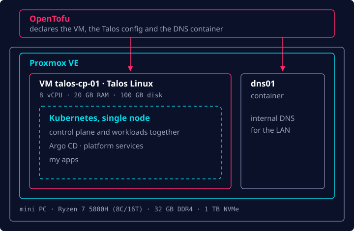

Durante a maior parte da minha carreira, tenho desenvolvido software e trabalhado com ferramentas
de Ops/Plataforma (Kubernetes, containers OCI/Docker, Terraform etc.), mas quase sempre como
usuário. Raramente tive a chance de participar do setup de um projeto do zero. Por isso, fazia
tempo que eu queria entender de verdade como as coisas funcionam de ponta a ponta, e decidi mudar
isso montando e operando um homelab.

Este é o primeiro de três posts sobre ele. Neste, eu vou do bare metal até um cluster Kubernetes
rodando. O próximo é sobre deixar o Git comandar esse cluster, e o último é sobre colocar uma
aplicação de verdade na internet.

## Como tudo começou

Alguns anos atrás, um grande amigo me vendeu um mini PC GenMachine e vivia me incentivando a montar
meu próprio homelab. Naturalmente, fui adiando por muito tempo, mas nos últimos meses mergulhei de
cabeça e agora tenho um setup humilde, porém capaz, rodando.

Primeiro, uma olhada nas especificações do hardware:

- **CPU:** Ryzen 7 5800H, 8 núcleos / 16 threads @ 3,2 GHz
- **RAM:** 32 GB (2 × 16 GB) DDR4 3200 MHz
- **SSD:** 1 TB NVMe

Meu objetivo com esse hardware era simples: eu queria um cluster Kubernetes para rodar meus
projetos, totalmente gerenciado por código via GitOps, com alguma folga para experimentar outras
tecnologias, como o Hermes Agent.

Então, mãos à obra.

## O hypervisor: Proxmox VE

O primeiro passo foi escolher um hypervisor para rodar as VMs. Hoje em dia essa é uma escolha
praticamente óbvia: a maioria das pessoas escolhe o Proxmox VE, eu incluso.

Criei um pendrive bootável com a imagem do Proxmox VE usando o balenaEtcher e dei boot no mini PC
por ele. Segui as instruções de instalação e, depois de alguns minutos, estava tudo no ar e eu já
conseguia acessar a interface web de administração.

## Tudo como código: OpenTofu

Depois disso, precisei decidir como gerenciar as VMs no hypervisor. Desde o começo eu sabia que
queria usar código, para poder reconstruir ou replicar o setup do zero e manter o histórico de cada
mudança. Depois de pesquisar um pouco, fiquei com o OpenTofu como ferramenta de IaC. Ele é um fork
open source do Terraform, da HashiCorp, e traz alguns recursos bem legais, como criptografia nativa
do state. Meu state fica criptografado em um bucket do Cloudflare R2.

## O cluster: Talos Linux

Em seguida, eu tinha outra decisão a tomar: como de fato rodar e gerenciar o cluster Kubernetes.
Eu tinha basicamente três opções: k3s, kubeadm e Talos Linux.

Acabei escolhendo o Talos Linux porque ele oferece uma experiência parecida com a dos serviços de
Kubernetes gerenciado dos grandes provedores de nuvem, como EKS, GKE e AKS. Alguns outros motivos
reforçaram essa decisão:

- Eu queria colocar algo no ar rápido, para começar a fazer deploy dos projetos em que já estava
  trabalhando.
- Com k3s e kubeadm, eu teria que instalar e gerenciar o sistema operacional por baixo por conta
  própria.
- O Talos é imutável e não tem nenhum ponto de acesso além da sua API de administração
  (`talosctl`). Não há SSH nem shell, o que reduz bastante a superfície de ataque.

Em vez de entrar no node, você faz perguntas à API dele:

```bash
talosctl -n 192.168.1.221 dashboard     # visão ao vivo do node
talosctl -n 192.168.1.221 logs kubelet  # logs de um serviço
```

## Um node, não três

Como ainda era um setup doméstico, com recursos limitados, optei por um cluster de um único node,
tudo em um: 8 vCPUs e 20 GB de RAM. No começo eu comecei a montar um cluster HA com 3 nodes, mas os
recursos logo ficaram escassos, e fiquei com medo de que as escritas extras do etcd encurtassem a
vida útil do SSD. Então mudei rapidamente para a arquitetura de um único node que roda até hoje.

No OpenTofu, esse node é uma única VM, aqui reduzida às partes interessantes:

```hcl
resource "proxmox_virtual_environment_vm" "cp" {
  for_each = var.nodes

  name      = each.key
  node_name = var.proxmox_node
  on_boot   = true

  cpu {
    cores = var.node_cpu # 8
    type  = "host"
  }

  memory {
    dedicated = var.node_memory_mb # 20480
    floating  = 0 # sem ballooning: o Kubernetes espera memória fixa
  }

  disk {
    datastore_id = "local-lvm"
    import_from  = proxmox_virtual_environment_download_file.talos.id
    size         = var.node_disk_gb # 100
  }
}
```

O disco é importado de uma imagem do Talos que o próprio OpenTofu baixa, e o mesmo código depois
aplica a configuração do Talos no node. A VM e o sistema operacional que roda nela ficam definidos
em um só lugar.

Isso deixa 4 GB de RAM para o próprio Proxmox e para um pequeno container de DNS interno (falo mais
dele na parte 3). Se o node cair, tudo cai junto. Para um homelab, é um trade-off que aceito de bom
grado, ainda mais porque tudo é código que posso reconstruir.

## Juntando tudo

Foi aqui que todas essas decisões foram parar, camada por camada:



## A seguir

Nesse ponto eu tinha um cluster Kubernetes com um node e pouca coisa além disso. No próximo post eu
entrego ele para o Git: Argo CD, secrets, rede e armazenamento.
