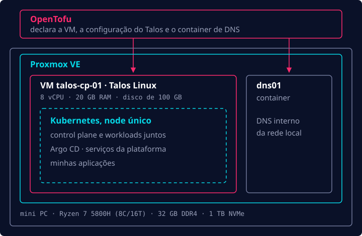

Passei a maior parte da carreira desenvolvendo software e trabalhando com ferramentas de
Ops/Plataforma (Kubernetes, containers OCI/Docker, Terraform etc.), mas quase sempre do lado de quem
só usa. Quase nunca tive a chance de montar um projeto do zero. Fazia tempo que eu queria entender
de verdade como tudo funciona de ponta a ponta, então resolvi montar e operar um homelab.

Este é o primeiro de uma série de três posts. Neste post, eu saio do bare metal e chego a um cluster
Kubernetes rodando. No próximo post, o Git passa a comandar o cluster, e no último post, eu coloco uma
aplicação de verdade na internet.

## Como tudo começou

Alguns anos atrás, um grande amigo me vendeu um mini PC GenMachine e vivia me incentivando a montar
meu próprio homelab. Eu fui empurrando com a barriga por um bom tempo, e de repente, nos últimos meses
mergulhei de cabeça nesse projeto e hoje tenho rodando um setup modesto, mas que dá conta do recado.

Primeiro, as specs da máquina:

- **CPU:** Ryzen 7 5800H, 8 núcleos / 16 threads @ 3,2 GHz
- **RAM:** 32 GB (2 × 16 GB) DDR4 3200 MHz
- **SSD:** 1 TB NVMe

Meu objetivo com esse hardware era simples: eu queria um cluster Kubernetes para rodar meus
projetos, totalmente gerenciado por código via GitOps, com alguma folga para experimentar outras
tecnologias, como o Hermes Agent.

Com esse objetivo em mente, botei a mão na massa.

## O hypervisor: Proxmox VE

O primeiro passo foi escolher um hypervisor para rodar as VMs. Hoje em dia isso quase não é dúvida:
a maioria das pessoas vai de Proxmox VE, e eu também fui.

Criei um pendrive bootável com a imagem do Proxmox VE usando o balenaEtcher e dei boot no mini PC
com ele. Segui as instruções de instalação e, em poucos minutos, estava tudo no ar e eu já acessava
a interface web de administração.

## Tudo como código: OpenTofu

Depois disso, precisei decidir como gerenciar as VMs no hypervisor. Desde o começo eu sabia que
queria usar código, para poder reconstruir ou replicar o setup do zero e manter o histórico de cada
mudança. Depois de pesquisar um pouco, fui de OpenTofu para o IaC. Ele é um fork open source do
Terraform, da HashiCorp, e traz alguns recursos bem legais, como criptografia nativa do state. Meu
state fica criptografado em um bucket do Cloudflare R2.

## O cluster: Talos Linux

A decisão seguinte era como rodar e gerenciar o cluster Kubernetes em si. Eu tinha basicamente três
opções: k3s, kubeadm e Talos Linux.

Acabei escolhendo o Talos Linux porque ele oferece uma experiência parecida com a dos serviços de
Kubernetes gerenciado dos grandes provedores de nuvem, como EKS, GKE e AKS. Pesaram também alguns
outros motivos:

- Eu queria subir algo rápido para começar a fazer deploy dos projetos em que já estava
  trabalhando.
- Com k3s ou kubeadm, eu mesmo teria que instalar e cuidar do sistema operacional da máquina.
- O Talos é imutável e não tem outra porta de entrada além da API de administração (`talosctl`).
  Não tem SSH nem shell, o que reduz bastante a superfície de ataque.

Em vez de logar no node, você consulta a API dele:

```bash
talosctl -n 192.168.1.221 dashboard     # visão ao vivo do node
talosctl -n 192.168.1.221 logs kubelet  # logs de um serviço
```

## Um node, não três

Como estamos falando de um setup caseiro, com recursos limitados, optei por um cluster de node único,
all-in-one: 8 vCPUs e 20 GB de RAM. Cheguei a começar a configurar um cluster HA com 3 nodes, mas os recursos
logo ficaram apertados, e fiquei receoso de que as escritas extras no `etcd` diminuíssem o tempo de vida útil do SSD. Então mudei para a arquitetura de node único que está rodando hoje em dia.

No OpenTofu, esse node é uma única VM, declarada via código (reduzido para as partes relevantes):

```hcl
resource "proxmox_virtual_environment_vm" "cp" {
  for_each = var.nodes

  name      = each.key
  node_name = var.proxmox_node
  on_boot   = true

  cpu {
    cores = var.node_cpu # 8
    type  = "host"
  }

  memory {
    dedicated = var.node_memory_mb # 20480
    floating  = 0 # sem ballooning: o Kubernetes espera memória fixa
  }

  disk {
    datastore_id = "local-lvm"
    import_from  = proxmox_virtual_environment_download_file.talos.id
    size         = var.node_disk_gb # 100
  }
}
```

A VM sobe a partir de uma imagem do Talos que o OpenTofu manda o Proxmox baixar, e depois o mesmo
código envia a configuração do Talos para o node e faz o bootstrap do Kubernetes. Com um só
`tofu apply`, eu saio de um Proxmox vazio e chego a um cluster rodando, com a VM e o sistema
operacional dela definidos lado a lado.

Após configurar o Talos Linux para rodar o cluster de Kubernetes, sobraram 4 GB de RAM para o próprio Proxmox rodar e para um pequeno servidor de DNS interno (falo mais dele na parte 3). Se o node cair, tudo cai junto. Para um homelab, é um trade-off que aceito tranquilo,
ainda mais porque dá para reconstruir tudo a partir do código.

## Juntando tudo

No fim, todas essas decisões ficaram assim, camada por camada:



## No próximo post

Até aqui, eu tinha um cluster Kubernetes de um node e nada mais. No próximo post eu passo o controle para o Git: Argo CD, secrets, rede e armazenamento.
