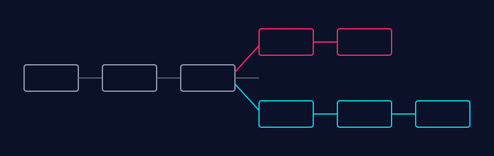

Este é um post de exemplo. Ele existe para conferir o layout: títulos, código, `código inline`, um
[link para o yabe](https://yabe.pdrlabs.com.br) e uma imagem.

## Encontrando onde as cadeias divergem

O indexador volta a partir do próprio topo, perguntando ao nó o hash de cada altura, até que os
dois concordem.

```ts
// volta até o nosso hash bater com o do nó
async function findForkPoint(stored: Block, node: Node): Promise<number> {
  let h = stored.height;
  while (stored.hash !== (await node.getBlockHash(h))) {
    h -= 1;
  }
  return h;
}
```



Como cada bloco é gravado na própria transação, uma queda deixa o banco de dados consistente.
